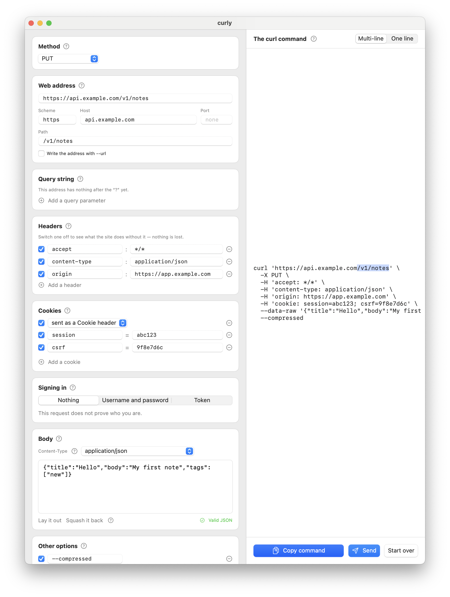

[日本語](README.ja.md) | [English](README.md) | [한국어](README.ko.md)
<!-- synced to README.md @ 599976b -->

# curly

**`curl` コマンドを分解して、中身が見えるようにする Mac アプリです。**

[](https://github.com/Bekind-Labs/curly/actions/workflows/ci.yml)


ブラウザの開発者ツールでリクエストを右クリックして **Copy as cURL** を選び、
curly に貼り付けてください。バックスラッシュだらけの長い一行が、名前のついた
編集できる部品に変わります。メソッド、アドレス、クエリ文字列、ヘッダー、
Cookie、ボディ、認証。どれかを変えると右側のコマンドが書き直され、いま触った
部分に対応するトークンが光ります。どの入力欄がコマンドのどの部分を作っている
のかが、そのまま見えるわけです。

あとはコマンドをコピーしてターミナルで実行します。あるいは **Send** を押せば、
下のペインに整形された答えが表示されます。

curly は教えるための道具として生まれました。どのセクションにも **?** があり、
HTTP リクエストのその部分が実際に何なのかを、専門用語を使わない 2〜3 文で
説明します。



### [⬇ macOS 版をダウンロード](https://github.com/Bekind-Labs/curly/releases/latest)

macOS 14 以降 · ユニバーサル（Apple silicon と Intel） · 無料

アカウント不要、テレメトリなし。コマンドは貼り付けで入り、コピーで出ていきます

## リクエストのどの部分も、さわって確かめられる

- **メソッド** — ポップアップで、独自の動詞も選べます。curl が指定ではなく推測で
  メソッドを決めているときは、そう教えてくれます。
- **アドレス** — スキーム、ホスト、ポート、パスがそれぞれ別の入力欄になり、
  クエリパラメータは行になります。生の URL を編集しても、部品を編集しても、
  両方向で同期します。値は読みやすい形（`swift ui`）で表示し、
  エスケープした形（`swift%20ui`）で保持します。
- **ヘッダー** — 1 行につきひとつ。削除ボタンだけでなく *有効・無効のスイッチ*
  があるので、ヘッダーを切って何が壊れるかを見て、また戻せます。
- **Cookie** — `Cookie:` ヘッダーを Cookie ごとの行に分けます。
  `cookie: a=1; b=2; c=3` は、コピーしたリクエストの中でいちばん読みにくい行
  だからです。
- **ボディ** — 生のテキスト。JSON なら整形と検証ができ、フォーム形式なら
  名前と値の行になります。`Content-Type` も歩調を合わせます。
- **認証** — `-u` と `Authorization: Basic …`/`Bearer …` を、ユーザー名と
  パスワード、あるいはトークンとして表示します。ヘッダー欄には本物のヘッダーが
  出たままで、親切な表示はそれを隠すのではなく編集します。
- **その他のオプション** — `--compressed`、`-L`、`-k` などをトグルにして、
  それぞれにやさしい説明を一行添えます。curly が知らないフラグも書かれたとおりに
  保たれ、ここに表示されます。黙って捨てられるものはありません。
- **表示する量** — curl の出力フラグ（`-s`、`-i`、`-v`）をひとつの選択にまとめた
  ものです。どの文字が何をするかを覚えていなくても、コマンドがどれだけ表示するか
  を決められます。

## インストール

[Releases](https://github.com/Bekind-Labs/curly/releases/latest) から zip を
ダウンロードし、展開して `curly.app` を Applications に入れ、開いてください。
リリースには zip と並んで `.sha256` も置いてあります。

自分でビルドしたいですか。必要なのは Swift のツールチェーンだけで、1 分も
かかりません。[ソースからビルドする](#ソースからビルドする)をご覧ください。

## ソースからビルドする

```bash
git clone https://github.com/Bekind-Labs/curly.git
cd curly
make test   # run the CurlKit tests
make run    # build curly.app and launch it
make app    # build curly.app, ready to double-click
```

## 作りの説明

SwiftPM のパッケージひとつにターゲットが 2 つ、第三者のライブラリへの依存は
ありません。

- **`CurlKit`** — UI をまったく含まないライブラリです。
  - `ShellTokenizer` は bash と同じやり方でコマンドラインを単語に分けます。
  - `CurlParser` はその単語を `CurlRequest` に変え、認識できないものは捨てずに
    そのまま保ちます。
  - `CurlRequest` は書かれた内容に忠実な素朴な値型（value type）です。フラグは
    書かれたとおりの綴りを保ち、クエリの値はエスケープされたまま残ります。
    使いやすい表示（Cookie、認証、フォーム項目、JSON）は、その同じフラグを
    読み書きする投影（projection）です。認証のセクションが親切でいられるのに
    ヘッダーのセクションが正直なままでいられるのは、この仕組みのおかげです。
  - `CurlGenerator` はリクエストを書き戻すと同時に、コマンドのどの範囲がどの
    入力欄から来たのかを記録します。ハイライトを動かしているのはこの対応表です。
- **`curly`** — SwiftUI のアプリで、ひとつの `CurlRequest` を映す窓です。

`RequestPlanner` は `CurlKit` にあり、Send が実際にネットワークへ送り出すもの
— メソッド、アドレス、ヘッダー、ボディ — を、ソケットを開かずに素朴な値として
組み立てます。おかげで間違えやすい部分（どのフラグがボディを変えるのか、
`Content-Type` は何になるのか、Cookie はどこへ行くのか）を Linux 上でテストでき、
アプリ側には薄い `URLSession` の呼び出しだけが残ります。

## 当然わいてくる疑問

**Postman / Insomnia / Bruno / HTTPie ではだめなのですか。**
それらはリクエストをアプリの中に抱え込みますが、教える場面ではその形が
合いません。学んでいる人の手元に残るのが、どこででも実行できるコマンドではなく
コレクションになってしまうからです。curly は [Bekind Labs](https://bekindlabs.com)
で、HTTP をまだ知らない開発者とペアを組むために作られました。だからコマンドが
文書であり、どのセクションも自分で自分を説明します。curly は curl コマンドを
ひとつ、見て、編集して、理解するためのものです。それ以上でも以下でもありません。
コレクションや環境設定やテストランナーが必要なら、それらのツールのほうが適任です。

**Send はコマンドを実行したときと同じように動きますか。**
そうなるようにしていますし、フラグから実際のリクエストへの変換はテストして
います。リダイレクトを追うのは `-L` があるときだけ、証明書の確認を省くのは
`-k` があるときだけです。アプリの中で送る以上どうしても扱えないフラグ
（たとえば `--proxy` や `--limit-rate`）もありますが、黙って無視するのではなく
レスポンスのペインに並べて示します。迷うときは、コマンドをコピーして実行して
ください。

**Linux や Windows では使えますか。**
アプリは SwiftUI 製で macOS 専用です。`CurlKit` — トークナイザ、パーサー、
モデル、ジェネレータという、面白い部分のほとんど — は UI を読み込まない
移植可能な Swift で、そのテストは CI の Linux 上で走っています。この上に
ターミナル版や GTK 版の画面を作るのは筋の通った話です。

**署名はされていますか。**
リリースのビルドは Bekind Labs の Developer ID で署名され、Apple の公証
（notarisation）を受けているので、Gatekeeper は何事もなく開かせてくれます。

**勝手に通信しますか。**
分析も更新確認もテレメトリもありません。いっさいです。送るリクエストは、あなたが
Send を押したものだけで、宛先はあなたのコマンドに書かれたアドレスです。その内容が
保存されたり、ほかのどこかへ送られたりすることはありません。読み取るのは
クリップボードだけで、それも読み込みを提案するためだけです。これは設定で
切れます。

## コントリビュート

Issue も Pull Request も歓迎します。`make test` が通っていること、そして
ユーザーに見える文字列を足したときは `make strings` で文字列カタログを
作り直すことをお願いします。翻訳のもとになった英語が変わっている場合はその旨が
示され、テストが通る前に更新する必要があります。CI は Linux でライブラリの
テストを走らせ、macOS でアプリをビルドします。

## Bekind Labs について

curly は [Bekind Labs](https://bekindlabs.com) が開発・保守しています。
Pivotal Labs 出身者が設立した東京のコンサルティング会社で、XP とモダナイゼーション
の仕事でクライアントのチームとペアを組んでいます。ご一緒したい方は
[こちらまでご連絡ください](mailto:greg@bekindlabs.com)。

## ライセンス

[MIT](LICENSE)。
