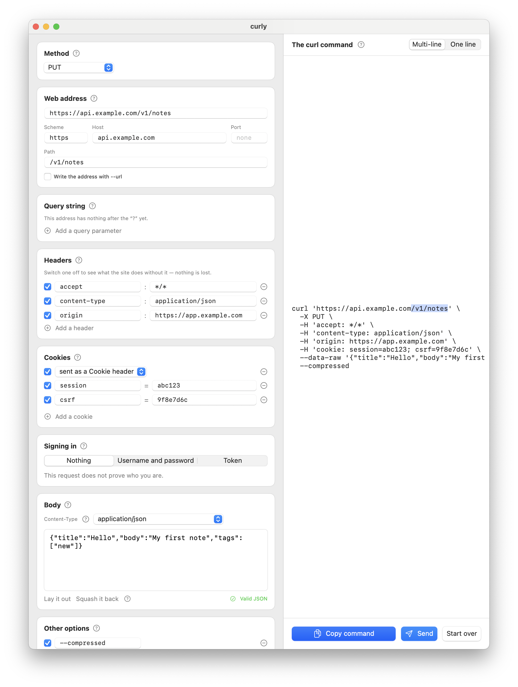

[한국어](README.ko.md) | [English](README.md) | [日本語](README.ja.md)
<!-- synced to README.md @ 599976b -->

# curly

**`curl` 명령을 분해해서 그 안에 무엇이 들어 있는지 보여 주는 Mac 앱입니다.**

[](https://github.com/Bekind-Labs/curly/actions/workflows/ci.yml)


브라우저의 개발자 도구에서 요청을 오른쪽 클릭해 **Copy as cURL**을 고르고
curly에 붙여 넣으세요. 역슬래시로 뒤덮인 긴 한 줄이 이름이 붙은, 고칠 수 있는
부품으로 바뀝니다. 메서드, 주소, 쿼리 문자열, 헤더, 쿠키, 본문, 인증. 그 가운데
무엇이든 고치면 오른쪽의 명령이 다시 쓰이고, 방금 건드린 부분에 해당하는 토큰에
불이 들어옵니다. 어느 입력란이 명령의 어느 조각을 만들어 내는지가 눈에 보이는
셈입니다.

그다음에는 명령을 복사해 터미널에서 실행하면 됩니다. 또는 **Send**를 누르면
아래 창에 보기 좋게 정리된 답이 나타납니다.

curly는 가르치기 위한 도구로 태어났습니다. 어느 항목에나 **?**가 있어서, HTTP
요청의 그 부분이 실제로 무엇인지를 전문 용어 없이 두세 문장으로 설명합니다.



### [⬇ macOS용 내려받기](https://github.com/Bekind-Labs/curly/releases/latest)

macOS 14 이상 · 유니버설(Apple silicon과 Intel) · 무료

계정도 텔레메트리도 없습니다. 명령은 붙여 넣기로 들어오고 복사로 나갑니다

## 요청의 어느 부분이든 만져 볼 수 있습니다

- **메서드** — 팝업이며 직접 만든 동사도 고를 수 있습니다. curl이 지정받은 것이
  아니라 스스로 메서드를 짐작하고 있을 때는 그렇다고 알려 줍니다.
- **주소** — 스킴, 호스트, 포트, 경로가 각각 별개의 입력란이 되고 쿼리
  파라미터는 줄이 됩니다. 원래의 URL을 고쳐도, 부품을 고쳐도 양쪽이 서로
  맞춰집니다. 값은 읽기 좋은 모양(`swift ui`)으로 보여 주고 이스케이프된
  모양(`swift%20ui`)으로 간직합니다.
- **헤더** — 한 줄에 하나씩이며, 삭제 버튼만이 아니라 *켜고 끄는 스위치*가
  있습니다. 헤더를 꺼서 무엇이 망가지는지 보고 다시 켤 수 있습니다.
- **쿠키** — `Cookie:` 헤더를 쿠키마다 한 줄로 나눕니다.
  `cookie: a=1; b=2; c=3`은 복사해 온 요청에서 가장 읽기 어려운 줄이기
  때문입니다.
- **본문** — 날것의 글입니다. JSON이면 보기 좋게 펼치고 검사할 수 있으며, 폼
  형식이면 이름과 값의 줄이 됩니다. `Content-Type`도 함께 맞춰집니다.
- **인증** — `-u`와 `Authorization: Basic …`/`Bearer …`를 사용자 이름과
  비밀번호, 또는 토큰으로 보여 줍니다. 헤더 항목에는 진짜 헤더가 그대로 남아
  있고, 친절한 쪽은 그것을 감추는 대신 고칩니다.
- **그 밖의 옵션** — `--compressed`, `-L`, `-k` 같은 것들을 스위치로 두고
  저마다 쉬운 설명을 한 줄씩 붙입니다. curly가 모르는 플래그도 적힌 그대로
  간직해 여기에 보여 줍니다. 말없이 버려지는 것은 없습니다.
- **얼마나 보여 줄지** — curl의 출력 플래그(`-s`, `-i`, `-v`)를 하나의 선택으로
  묶은 것입니다. 어느 글자가 무엇을 하는지 외우지 않아도 명령이 얼마나 보여 줄지
  정할 수 있습니다.

## 설치

[Releases](https://github.com/Bekind-Labs/curly/releases/latest)에서 zip을
내려받아 풀고 `curly.app`을 Applications에 넣은 다음 여세요. 릴리스에는 zip
옆에 `.sha256`도 함께 올라갑니다.

직접 빌드하고 싶으신가요? 필요한 것은 Swift 툴체인뿐이고 1분도 걸리지 않습니다.
[소스에서 빌드하기](#소스에서-빌드하기)를 보세요.

## 소스에서 빌드하기

```bash
git clone https://github.com/Bekind-Labs/curly.git
cd curly
make test   # run the CurlKit tests
make run    # build curly.app and launch it
make app    # build curly.app, ready to double-click
```

## 어떻게 만들어졌나

SwiftPM 패키지 하나에 타깃이 둘, 제삼자 라이브러리 의존은 없습니다.

- **`CurlKit`** — UI가 전혀 들어 있지 않은 라이브러리입니다.
  - `ShellTokenizer`는 bash와 같은 방식으로 명령줄을 낱말로 나눕니다.
  - `CurlParser`는 그 낱말을 `CurlRequest`로 바꾸며, 알아보지 못하는 것은 버리지
    않고 그대로 간직합니다.
  - `CurlRequest`는 적힌 내용에 충실한 수수한 값 타입(value type)입니다. 플래그는
    적힌 철자 그대로 남고 쿼리 값은 이스케이프된 채로 남습니다. 보기 편한
    쪽(쿠키, 인증, 폼 항목, JSON)은 그 같은 플래그를 읽고 쓰는
    투영(projection)입니다. 인증 항목이 친절하면서도 헤더 항목이 정직할 수 있는
    까닭이 이것입니다.
  - `CurlGenerator`는 요청을 다시 써 내는 동시에, 명령의 어느 구간이 어느
    입력란에서 왔는지를 기록합니다. 강조 표시를 움직이는 것이 이 대응표입니다.
- **`curly`** — SwiftUI 앱이며, 하나의 `CurlRequest`를 들여다보는 창입니다.

`RequestPlanner`는 `CurlKit`에 있으며, Send가 실제로 네트워크에 내보낼 것
— 메서드, 주소, 헤더, 본문 — 을 소켓을 열지 않고 수수한 값으로 꾸려 냅니다.
덕분에 틀리기 쉬운 부분(어떤 플래그가 본문을 바꾸는지, `Content-Type`이 무엇이
되는지, 쿠키가 어디로 가는지)을 Linux에서 테스트할 수 있고, 앱 쪽에는 얇은
`URLSession` 호출만 남습니다.

## 품어 봄직한 질문들

**Postman / Insomnia / Bruno / HTTPie는 왜 안 되나요?**
그것들은 요청을 앱 안에 가두는데, 가르치는 데에는 그 모양이 맞지 않습니다.
배우는 사람의 손에 남는 것이 어디서든 실행할 수 있는 명령이 아니라 컬렉션이
되어 버리기 때문입니다. curly는 [Bekind Labs](https://bekindlabs.com)에서 아직
HTTP를 모르는 개발자와 짝을 이뤄 일하려고 만들었습니다. 그래서 명령이 곧
문서이고, 모든 항목이 스스로를 설명합니다. curly는 curl 명령 하나를 보고,
고치고, 이해하기 위한 것입니다. 그 이상도 이하도 아닙니다. 컬렉션이나 환경 설정,
테스트 러너가 필요하다면 그런 도구들이 제격입니다.

**Send는 명령을 실행한 것과 똑같이 움직이나요?**
그렇게 하려는 것이 의도이고, 플래그에서 실제 요청으로 옮기는 과정은 테스트하고
있습니다. 리다이렉트를 따라가는 것은 `-L`이 있을 때뿐이고 인증서 확인을 건너뛰는
것은 `-k`가 있을 때뿐입니다. 앱 안에서 보내는 이상 들어줄 수 없는 플래그도
있는데(예를 들어 `--proxy`와 `--limit-rate`), 말없이 무시하는 대신 응답 창에
적어 보여 줍니다. 헷갈릴 때는 명령을 복사해 실행해 보세요.

**Linux나 Windows에서도 되나요?**
앱은 SwiftUI로 만들어 macOS 전용입니다. `CurlKit` — 토크나이저, 파서, 모델,
제너레이터, 그러니까 재미있는 부분의 대부분 — 은 UI를 들여오지 않는 이식
가능한 Swift이고 그 테스트는 CI의 Linux에서 돕니다. 그 위에 터미널이나 GTK용
화면을 올리는 것은 해 볼 만한 일입니다.

**서명되어 있나요?**
릴리스 빌드는 Bekind Labs의 Developer ID로 서명되고 Apple의
공증(notarisation)을 받으므로 Gatekeeper가 별다른 절차 없이 열어 줍니다.

**몰래 어딘가로 연결하나요?**
분석도, 업데이트 확인도, 텔레메트리도 없습니다. 전혀 없습니다. 보내는 요청은
당신이 Send를 누른 것뿐이고 목적지는 당신의 명령에 적힌 주소입니다. 그 내용이
저장되거나 다른 어딘가로 보내지는 일은 없습니다. 읽는 것은 클립보드뿐이며,
그것도 가져오기를 권하기 위해서일 뿐입니다. 이 동작은 설정에서 끌 수 있습니다.

## 기여하기

이슈와 풀 리퀘스트를 환영합니다. `make test`가 통과해야 하고, 사용자에게 보이는
글을 더했다면 `make strings`로 문자열 카탈로그를 다시 만들어 주세요. 번역의
바탕이 된 영어가 바뀐 경우에는 그 사실이 표시되며, 테스트가 통과하려면 먼저
고쳐야 합니다. CI는 Linux에서 라이브러리 테스트를 돌리고 macOS에서 앱을
빌드합니다.

## Bekind Labs 소개

curly는 [Bekind Labs](https://bekindlabs.com)가 만들고 관리합니다. Pivotal Labs
출신들이 세운 도쿄의 컨설팅 회사로, XP와 현대화(modernisation) 작업에서 고객
팀과 짝을 이뤄 일합니다. 함께 일하고 싶으시다면
[연락 주세요](mailto:greg@bekindlabs.com).

## 라이선스

[MIT](LICENSE).
