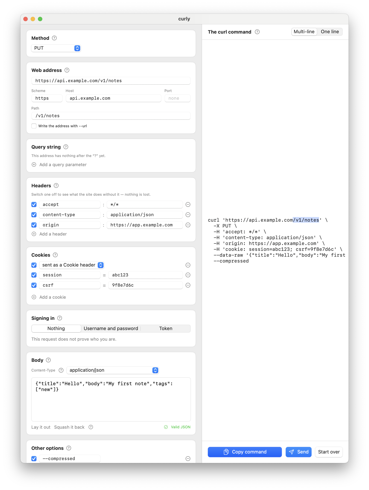

[English](README.md) | [日本語](README.ja.md) | [한국어](README.ko.md)

# curly

**A Mac app that takes a `curl` command apart so you can see what's in it.**

[](https://github.com/Bekind-Labs/curly/actions/workflows/ci.yml)


Right-click a request in your browser's developer tools, **Copy as cURL**, and
paste it into curly. The wall of backslashes becomes labelled, editable parts:
method, address, query string, headers, cookies, body, auth. Change any of them
and the command rewrites itself on the right, with the tokens you just touched
lit up — so you can see which field produces which piece of the command.

Then you copy the command back out and run it in your terminal — or press
**Send** and see the answer in a pane underneath, pretty-printed.

curly was born as a teaching tool — every section has a **?** that explains,
in two or three jargon-free sentences, what that part of an HTTP request
actually is.



### [⬇ Download for macOS](https://github.com/Bekind-Labs/curly/releases/latest)

macOS 14 or later · universal (Apple silicon and Intel) · free

No accounts, no telemetry — the command goes in by paste and comes out by copy

## Every part of the request is a thing you can poke

- **Method** — a popup, including custom verbs. It tells you when curl is
  inferring the method rather than being told.
- **Address** — scheme, host, port and path as separate fields, plus query
  parameters as rows. Edit the raw URL or the parts; they stay in sync both
  ways. Values are shown decoded (`swift ui`) and stored escaped (`swift%20ui`).
- **Headers** — one row each, with an *enable switch* rather than just a delete
  button, so you can turn a header off, see what breaks, and turn it back on.
- **Cookies** — the `Cookie:` header split into one row per cookie, because
  `cookie: a=1; b=2; c=3` is the least readable line in any copied request.
- **Body** — raw text, with pretty-printing and validation for JSON, and
  key/value rows for form-encoded bodies. `Content-Type` stays in step.
- **Auth** — `-u` and `Authorization: Basic …`/`Bearer …` shown as a username
  and password or a token. The Headers section still shows the real header; the
  friendly view edits it rather than hiding it.
- **Other options** — `--compressed`, `-L`, `-k` and the rest as toggles, each
  with one line of plain English. Flags curly doesn't recognise are kept exactly
  as written and shown here too. Nothing is ever silently dropped.
- **How much to show** — curl's output flags (`-s`, `-i`, `-v`) as a single
  choice, so you can set how much the command prints without remembering which
  letter does what.

## Installing

Download the zip from [Releases](https://github.com/Bekind-Labs/curly/releases/latest),
unzip, drag `curly.app` to Applications, open it. Each release also ships a
`.sha256` next to the zip.

Prefer to build it yourself? It needs nothing but a Swift toolchain and takes
well under a minute — see [Building from source](#building-from-source).

## Building from source

```bash
git clone https://github.com/Bekind-Labs/curly.git
cd curly
make test   # run the CurlKit tests
make run    # build curly.app and launch it
make app    # build curly.app, ready to double-click
```

## How it's put together

Two targets in one SwiftPM package, no third-party dependencies:

- **`CurlKit`** — a library with no UI in it at all.
  - `ShellTokenizer` splits a command line the way bash would.
  - `CurlParser` turns the words into a `CurlRequest`, keeping anything it
    doesn't recognise verbatim rather than dropping it.
  - `CurlRequest` is a plain value type that stays faithful to what was
    written — flags keep their spelling, query values keep their escaping. The
    friendlier views (cookies, auth, form fields, JSON) are projections that
    read and write those same flags, which is how the Auth section can be
    friendly while the Headers section stays honest.
  - `CurlGenerator` writes the request back out *and* records which stretch of
    the command came from which field. That map is what drives the highlighting.
- **`curly`** — the SwiftUI app, which is a view onto one `CurlRequest`.

`RequestPlanner` lives in `CurlKit` and works out what Send would actually put
on the wire — method, address, headers, body — as a plain value, without
opening a socket. That keeps the fiddly part (which flags change the body, what
the implied `Content-Type` is, where cookies end up) testable on Linux, and
leaves the app with a thin `URLSession` call.

## Questions you might reasonably have

**Why not Postman / Insomnia / Bruno / HTTPie?**
They keep the request inside the app, which is the wrong shape for teaching:
whoever's learning walks away with a collection instead of a command they can
run anywhere. curly was built at [Bekind Labs](https://bekindlabs.com) for
pairing with developers who don't know HTTP yet, so the command is the document
and every section explains itself. It's for viewing, editing and understanding
one curl command — no more, no less. If you need collections, environments or a
test runner, those tools are the right ones.

**Does Send behave the same as running the command?**
That's the intent, and the translation from flags to an actual request is
tested. It follows redirects only with `-L` and skips certificate checks only
with `-k`. Some flags it can't honour when sending in-process — `--proxy` and
`--limit-rate`, for instance — and rather than quietly ignoring them it lists
them in the response pane. When in doubt, copy the command and run it.

**Linux or Windows?**
The app is SwiftUI and macOS-only. `CurlKit` — the tokenizer, parser, model and
generator, which is most of the interesting code — is portable Swift with no UI
imports and its tests run on Linux in CI. A terminal or GTK front end would be a
reasonable thing to build on top.

**Is it signed?**
Release builds are signed with Bekind Labs' Developer ID and notarised by
Apple, so Gatekeeper lets them open without ceremony.

**Does it phone home?**
No analytics, no update check, no telemetry. Ever. The only requests it ever
makes are the ones you press Send on, to the address in your own command, and
nothing about them is stored or sent anywhere else. The only thing it reads is
your clipboard, and only to offer an import — there's a preference to turn that
off.

## Contributing

Issues and pull requests are welcome. `make test` should be green, and
`make strings` regenerates the string catalogs if you add any user-facing text.
A translation whose English has changed since it was written is flagged and has
to be updated before the tests pass. CI runs the library tests on Linux and
builds the app on macOS.

## About Bekind Labs

curly is maintained by [Bekind Labs](https://bekindlabs.com), a Tokyo
consultancy founded by Pivotal Labs alumni that pairs with client teams on XP
and modernisation work. If you'd like to work with us,
[get in touch](mailto:greg@bekindlabs.com).

## Licence

[MIT](LICENSE).
